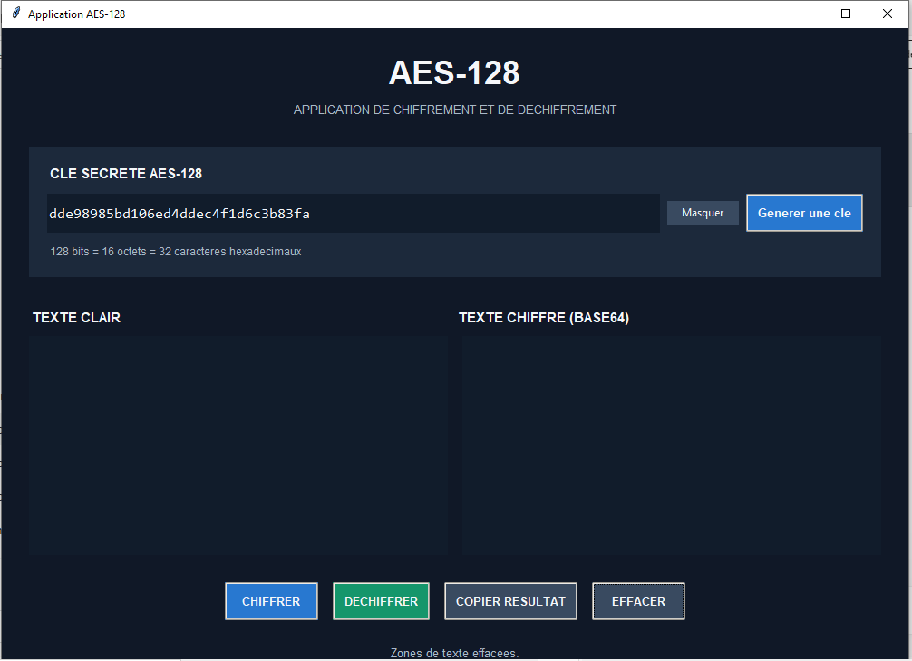

# Conception et réalisation d'un programme de chiffrement et déchiffrement basé sur AES-128

## 1. Présentation du projet

Ce projet consiste à concevoir et réaliser une application permettant de chiffrer et de déchiffrer des messages à l'aide de l'algorithme AES-128 (Advanced Encryption Standard).

L'application est développée en Python et dispose d'une interface graphique permettant à l'utilisateur de saisir un texte, de définir une clé et d'effectuer les opérations de chiffrement et de déchiffrement.

## 2. Objectifs

- Comprendre le fonctionnement de l'algorithme AES-128.
- Implémenter manuellement les principales transformations de l'AES.
- Réaliser le chiffrement et le déchiffrement des données.
- Développer une interface graphique simple et conviviale.
- Vérifier le bon fonctionnement de l'algorithme à travers des tests.

## 3. Technologies utilisées

- Langage de programmation : Python
- Interface graphique : Tkinter
- Algorithme cryptographique : AES-128
- Mode opératoire : CBC
- Encodage des résultats : Base64

## 4. Structure du projet

```text
projet-AES128/
│
├── aes.py
├── test_aes.py
├── main.py
└── README.md
```

## 5. Fonctionnalités

- Saisie d'une clé AES-128 de 128 bits.
- Génération automatique d'une clé aléatoire.
- Chiffrement d'un texte.
- Déchiffrement d'un texte chiffré.
- Affichage du résultat dans l'interface graphique.
- Copie et effacement des données.

## 6. Installation et exécution

Installer Python, puis ouvrir un terminal dans le dossier du projet.

Exécuter les tests :

```bash
python test_aes.py
```

Lancer l'application :

```bash
python main.py
```

## 7. Conclusion

Ce projet permet de mettre en pratique les concepts fondamentaux de la cryptographie symétrique à travers l'algorithme AES-128. Il associe l'étude théorique de l'algorithme à une réalisation pratique en Python.
Projet personnel – Conception et réalisation d'une application de chiffrement et déchiffrement basée sur AES-128. »
## 8. Aperçu de l'application


